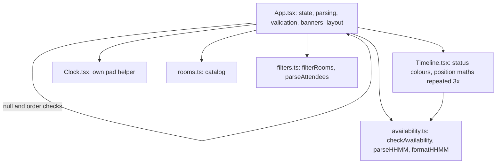
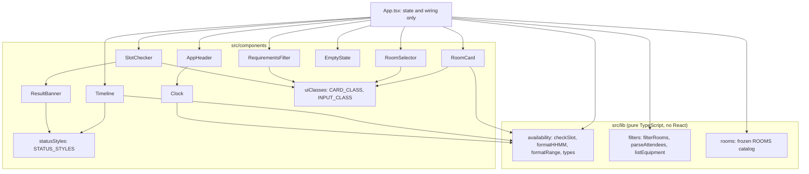

# Architecture

Room Availability Checker is a single-page React app with no backend. Domain rules live in plain TypeScript under `src/lib`, and React components only render and wire events.

## Before

The state before this refactor: `App.tsx` held state, validation, status banners and layout together, `Timeline` had its own status colours and position maths, and `Clock` had its own padding helper.

## After

`App.tsx` keeps only state and wiring. Each component has one job, and all validation, formatting, filtering and status styling sit in one module each.

## Design decisions

1. **Domain logic is pure and separate from React.** `checkSlot`, `filterRooms` and `parseAttendees` take plain data and return plain data, with no hooks or DOM. They can be unit-tested directly in Node without rendering anything, which the component tree cannot offer.

2. **One validation entry point.** `checkSlot` in `src/lib/availability.ts` parses the times, checks their order and range, applies the blocked rule and detects overlaps, and returns the status, the message and the valid slot. The UI never re-checks these rules. Before this, the same rules were in three places (`checkAvailability`, `App.tsx`, `Timeline.tsx`), so they could drift apart.

3. **Status styling lives in one map keyed by one union type.** `AvailabilityStatus` is declared once, and `STATUS_STYLES` has an entry for every status. TypeScript refuses to compile if a status is added without a style, so the banner and timeline cannot disagree about colours.

4. **Results are derived, not stored.** The availability result is recalculated from the current room and times on each render. A result for one room cannot linger after the selection changes, which satisfies the stale-result requirement without any cache invalidation logic.

5. **The catalog is immutable by construction.** `ROOMS` is frozen and typed `readonly`, so booking data cannot be changed by accident, which keeps acceptance criterion AC5 enforced by the compiler and the runtime.
